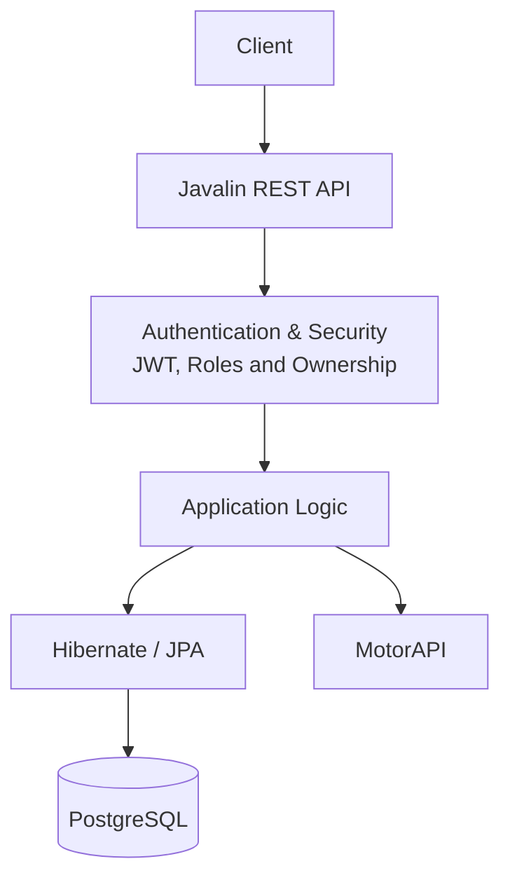

# MyGarage — Digital Vehicle Service Book

MyGarage is a Java REST API for managing vehicle information and maintenance history. Users can import vehicle data by registration number through an integration with MotorAPI. Depending on the information available from the external service, the import can populate vehicle details and inspection information without requiring users to enter every field manually.

Users can manage their vehicles and keep track of service records, expenses and modifications in one place. The backend uses JWT authentication, role-based authorization and resource-ownership checks to protect user data.

## Project Links

- **Source code:** [GitHub Repository](https://github.com/jasminagar/MyGarage)
- **Portfolio:** [View Portfolio](https://jasminagar.github.io/MyGarage/)
- **Deployed link:** [Deployed API](http://165.245.241.134:7070/api/v1/)

## Features

- **Vehicle management:** Create, retrieve, update and delete vehicle records.
- **Vehicle import:** Import available vehicle and inspection information from MotorAPI using a registration number.
- **Service history:** Store and manage service records associated with a vehicle.
- **Expense tracking:** Record and manage vehicle-related expenses.
- **Modification tracking:** Keep a record of vehicle modifications.
- **Database persistence:** Persist application data in PostgreSQL using Hibernate and JPA.
- **Authentication:** Authenticate users with JSON Web Tokens (JWT).
- **Authorization:** Apply role-based access control and resource-ownership checks.
- **Data transfer objects:** Use DTOs to control how data enters and leaves the application.
- **Automated testing:** Test database operations, service-layer rules and HTTP endpoint behaviour.

## Technology Stack

| Technology | Purpose |
|---|---|
| Java 17 | Backend language |
| Javalin 6 | REST API and HTTP routing |
| Maven | Dependency management and build automation |
| Hibernate 6 / JPA | Object-relational mapping and persistence |
| PostgreSQL | Relational database |
| Jackson | JSON serialization and deserialization |
| JWT (Auth0 Java JWT) | Token-based authentication |
| jBCrypt | Password hashing |
| JUnit 6 | Automated testing |
| REST Assured | HTTP API testing |
| Mockito | Mocking dependencies in tests |
| Testcontainers | Database-backed integration testing |
| SLF4J / Logback | Application logging |

## Architecture

MyGarage separates HTTP handling, application logic, persistence and external API integration. A request enters through a Javalin route, is checked by the authentication and authorization mechanisms, and is then handled by the relevant application logic. Data access is performed through the persistence layer using Hibernate/JPA and PostgreSQL. Vehicle imports also communicate with MotorAPI.


                             Client
                           |
                           v
                    Javalin REST API
                           |
                           v
                Authentication & Authorization
                   JWT, roles and ownership
                           |
                           v
                    Route / Controller
                           |
                           v
                     Service Layer
                    /             \
                   v               v
              DAO Layer         MotorAPI
                   |
                   v
             Hibernate / JPA
                   |
                   v
               PostgreSQL



The diagram shows the main responsibilities and request flow. It is a conceptual overview rather than a class-by-class representation of the codebase.


### Key Design Decisions

**REST API with Javalin**

Javalin provides a lightweight way to define HTTP routes and expose backend functionality through a REST API. Separating the API from the client allows the backend to be developed and tested independently. HTTP methods communicate the intended operation, while resource-oriented URLs provide a consistent interface for clients and tools such as Postman and REST Assured.

**Persistence with JPA and Hibernate**

JPA provides the persistence annotations and interfaces used to map Java objects to relational data. Hibernate implements this object-relational mapping, while PostgreSQL stores the application data. This approach makes entity relationships and database operations easier to manage than manually mapping every query result. PostgreSQL also provides transactions and relational constraints that help maintain data integrity.

**JWT authentication and authorization**

JWTs allow the client to authenticate subsequent requests by sending a token in the Authorization header. Authentication establishes the identity of the requester; authorization determines which actions that requester may perform. The design therefore considers both user roles and resource ownership when protecting operations. Role-based checks restrict access to functionality according to a user's permissions, while ownership checks ensure that users cannot access or modify resources belonging to other users merely by changing an identifier in a request. This separation provides a clearer security model and reduces the risk of unauthorized data access.

**DTOs and external API integration**

DTOs separate data exchanged with clients or external services from the entities used for persistence. This is useful when integrating MotorAPI because its response structure does not necessarily match the application's database model. External data can be mapped into DTOs, validated and converted into application entities. This reduces coupling between the external service and the database model and gives the application control over which fields are accepted or exposed.

**Partial updates**

Partial updates were chosen to allow clients to modify individual vehicle attributes without resending the complete resource. This reduces unnecessary data transfer and makes the API more convenient to use, particularly when only a small number of fields need to change. However, partial updates introduce an important design consideration: the backend must distinguish between a field that was omitted from the request and a field that was explicitly supplied with a value such as null. An omitted field should generally remain unchanged, whereas an explicitly supplied value must be handled according to the field's validation and business rules. The implementation must therefore apply updates selectively, validate the resulting data and prevent protected or immutable fields from being modified unintentionally. This approach provides flexibility for clients while preserving the integrity of the stored vehicle data.

**Automated testing**

Automated testing was included to verify the behaviour of the application at different levels and to reduce the risk of regressions when the implementation changes. Unit tests can verify individual components and business rules in isolation, while API tests can check endpoint behaviour, HTTP status codes, response structures and error handling. Authentication and authorization tests are particularly important because they verify that protected operations reject missing or invalid tokens and prevent users from accessing resources they do not own. Mocking external dependencies, such as MotorAPI, allows vehicle import logic to be tested without relying on network availability or changes in the external service. This makes tests more predictable and repeatable. Combining these testing approaches provides greater confidence that individual components work correctly and that the backend behaves as expected when its components interact.

## Data Model

The database separates users, vehicles and the different types of vehicle-related records. The main entities are User, Role, Vehicle, inspection, Expense and Modification.
- A User represents an account and is associated with the vehicles that user owns.
- A Role represents an authorization role used when determining which operations a user may perform.
- A Vehicle stores the core information about a vehicle and is associated with its owner.
- An InspectionRecord stores an inspection or maintenance entry associated with a vehicle.
- An Expense stores a cost associated with a vehicle.
- A Modification stores information about a change made to a vehicle.
A user can own multiple vehicles. A vehicle can have multiple inspection records, expenses and modifications. Keeping these record types separate avoids repeating the vehicle's core information in every related record. Instead, related records refer to the relevant vehicle through database relationships.

This structure supports a normalized relational model: each entity has a defined responsibility, and vehicle information is maintained in one place rather than copied into every inspection, expense or modification record. Primary keys identify records, while foreign keys maintain relationships between them. Database constraints help prevent records from referring to parent records that do not exist.

Authorization is related to, but separate from, the database relationships. A valid relationship between a user and a vehicle does not by itself authorize every request. The backend must check the requesting user's permissions and, where applicable, verify that the user owns the vehicle associated with the requested record.

The complete database structure and entity relationships are illustrated in the [ER diagram](diagrams/ER-diagram.png).

**Important entities**

### User and Role
The User entity represents a registered account. It stores the information needed to identify and authenticate a user, including a username and a password hash. Passwords should not be stored in plain text; jBCrypt is used to hash passwords for secure storage and verification.

The Role entity represents a user's authorization level. Roles support role-based access control, but they do not replace ownership validation. For example, a user may have permission to use an expense endpoint while still being restricted to expenses belonging to their own vehicles.

### Vehicle
The Vehicle entity is the central entity for vehicle-related information. It stores details such as make, model, year, mileage, registration number and technical specifications. Each vehicle is associated with its owner.

A vehicle can have multiple inspection records, expenses and modifications. These are stored as separate records linked to the vehicle, so the same vehicle details do not need to be repeated in each entry. This makes it possible to retrieve a vehicle together with its maintenance, financial and modification history.

Vehicle information can be entered through the application or populated through the MotorAPI import flow. Imported values should still be mapped and validated before being persisted; external data availability does not guarantee that every field is present or current.
InspectionRecord, Expense and Modification
InspectionRecord, Expense and Modification represent different kinds of information associated with a vehicle. Separating them allows each type of record to have its own fields and operations.

Inspection records support the vehicle's maintenance history. Expenses make it possible to track costs, while modifications document changes made to the vehicle. Since each record is linked to a vehicle, the application can retrieve the relevant history without duplicating the vehicle's core attributes.

## Security and Input Validation

Security is enforced by the backend rather than relying on client-side restrictions.

- **Authentication:** Protected requests must include a valid JWT in the Authorization header.
- **Role-based authorization:** The backend checks whether the authenticated user has a role permitted to perform the requested operation.
- **Ownership validation:** For user-owned resources, the service layer checks that the requested vehicle or related record belongs to the requesting user.
- **Password handling:** Passwords are hashed using jBCrypt rather than stored as plain text.
- **Input validation:** Request data is checked before it is processed or persisted. DTOs help control which fields clients can submit.

A valid JWT only establishes the identity of the requester. It does not automatically grant access to every resource. The backend must also enforce the relevant role and ownership rules.

# API Documentation

## API Documentation

The API exposes endpoints for authentication, vehicle import and CRUD operations on vehicles and their related records. The examples below document selected endpoints; they are not an exhaustive list of every route in the application. Most resource endpoints follow a conventional CRUD structure, but their exact paths, permissions and request bodies depend on the resource.

### CRUD Operations

| Operation | HTTP Method | Purpose |
|---|---|---|
| Create | `POST` | Creates a resource. |
| Read | `GET` | Retrieves a resource or collection. |
| Update | `PUT` | Updates a resource according to the endpoint's implementation. |
| Delete | `DELETE` | Deletes a resource. |

### Main Endpoints

| Method | Endpoint | Purpose | Authentication |
|---|---|---|---|
| `POST` | `/api/v1/auth/register` | Registers a user account. | Not required |
| `POST` | `/api/v1/auth/login` | Authenticates a user and returns a JWT. | Not required |
| `POST` | `/api/v1/service-records/import/{registrationNumber}` | Imports vehicle information using a registration number. | Required (`USER` or `ADMIN`) |

The table lists selected endpoints to demonstrate the API's main entry points. Other vehicle, service-record, expense and modification operations follow the resource patterns implemented in the source code.

### Authentication

After a successful login, the client receives a JWT. Include that token in the `Authorization` header when calling protected endpoints:

```http
Authorization: Bearer <JWT_TOKEN>
```

Replace `<JWT_TOKEN>` with the token returned by the login endpoint. The backend validates the token and then applies the relevant authorization checks.

When using the IntelliJ HTTP Client, the token can be stored in a global variable after the login request:

```http
> 
```

It can then be reused in subsequent requests:

```http
Authorization: Bearer {{token}}
```

### 1. Register a User

Creates a new user account. Authentication is not required.

**Request**

```http
POST /api/v1/auth/register
Content-Type: application/json
```

**Request body**

```json
{
  "username": "your_username",
  "password": "your_password"
}
```

**Successful response — `201 Created`**

```json
{
  "username": "your_username"
}
```

### 2. Log In

Authenticates a user and returns a JWT for subsequent requests.

**Request**

```http
POST /api/v1/auth/login
Content-Type: application/json
```

**Request body**

```json
{
  "username": "your_username",
  "password": "your_password"
}
```

**Successful response — `200 OK`**

```json
{
  "token": "<JWT_TOKEN>",
  "username": "your_username"
}
```

Include the returned token in the `Authorization` header when accessing protected endpoints.

### 3. Import a Vehicle

Imports available vehicle information using its registration number. The backend retrieves data from MotorAPI and maps the response into the application's data model.

**Request**

```http
POST /api/v1/service-records/import/CR48908
Authorization: Bearer <JWT_TOKEN>
```

Replace `CR48908` with the vehicle's registration number and `<JWT_TOKEN>` with a valid token.

**Successful response — `201 Created`**

```json
{
  "id": 1,
  "make": "Example Make",
  "model": "Example Model",
  "variant": "Example Variant",
  "year": 2020,
  "mileage": 85000,
  "registrationNumber": "CR48908",
  "vin": "EXAMPLEVIN12345678",
  "fuelType": "Petrol",
  "engineVolume": 1998,
  "enginePower": 150,
  "doors": 5,
  "seats": 5,
  "totalWeight": 2000,
  "lastInspectionDate": [
    2025,
    10,
    28
  ],
  "inspectionResult": "Approved",
  "nextInspectionDate": [
    2027,
    10,
    28
  ]
}
```

The response values are illustrative and are not verified data returned by MotorAPI. The date arrays show the date structure used in the example: `[year, month, day]`. Actual fields and values depend on the data returned by the external service and the application's mapping.

The endpoint requires authentication and is available to users with the `USER` or `ADMIN` role. The backend must also apply the relevant authorization and ownership rules when associating imported data with a user.

### 4. Update an Expense

The following example shows an expense update request. The URL contains two identifiers: `60` is the vehicle ID and `10` is the expense ID.

**Request**

```http
PUT http://localhost:7070/api/v1/expenses/car/60/update/10
Authorization: Bearer <JWT_TOKEN>
Content-Type: application/json
```

**Request body**

```json
{
  "date": "2026-10-07",
  "category": "TEST",
  "amount": 600,
  "description": "TEST"
}
```

The request body contains the expense date, category, amount and description. The example sends all four fields; clients should not assume that omitted fields remain unchanged unless that behaviour is explicitly implemented by the endpoint.

The endpoint requires a valid JWT and is available to users with the `USER` or `ADMIN` role. The backend must also verify that the requester is permitted to modify the expense, including checking ownership of the associated vehicle where required.

### HTTP Status Codes

The API uses HTTP status codes to communicate the outcome of a request. The following table describes common statuses relevant to the documented operations.

| Status Code | Meaning |
|---|---|
| `200 OK` | The request completed successfully. |
| `201 Created` | A resource was created successfully. |
| `400 Bad Request` | The request contains invalid data or fails validation. |
| `401 Unauthorized` | Authentication is missing, invalid or unsuccessful. |
| `403 Forbidden` | The user is authenticated but lacks the required permission. |
| `404 Not Found` | The requested resource could not be found. |

The exact status code and response body for an error depend on the endpoint and the application's exception handling.

## Testing

The backend uses a combination of testing tools to verify individual components, API endpoints and database interactions. Each tool serves a different purpose, helping ensure that the application behaves correctly both in isolation and as a complete system.

- **JUnit:** Provides the foundation for writing and running tests. It is used to verify business logic and expected behaviour, such as calculating modification costs, validating input and handling different outcomes.
- **Mockito:** Makes it possible to replace dependencies with mock objects. This allows services to be tested independently by controlling the behaviour of DAOs or other dependencies without requiring a real database.
- **REST Assured:** Tests the REST API through HTTP requests. It is used to verify endpoint behaviour, response status codes and returned data, including successful requests and error responses.
- **Testcontainers:** Starts a PostgreSQL instance in a container for integration tests. This allows database operations to be tested against a real PostgreSQL database, helping identify issues that mocks alone would not reveal.

### Test Scenarios

The tests cover database operations, service-layer security and API behaviour. Different testing tools are used depending on which part of the application is being tested.

- **Expense CRUD operations:** `ExpenseDAOTest` verifies that expenses can be created, retrieved by ID, retrieved by car ID and deleted. It also checks that creating an expense for a nonexistent car throws a `NotFoundResponse`. These tests use PostgreSQL through Testcontainers, allowing the DAO to be tested against a real database.

- **Expense service security:** `ExpenseServiceTest` verifies that an expense cannot be deleted if it does not exist, that administrators can delete expenses, and that users can delete expenses belonging to their own cars. It also tests that users are forbidden from deleting expenses associated with another user's car. Mockito is used to mock the DAO and security service, allowing the authorization logic to be tested independently of the database.

- **Vehicle import authentication:** `ImportVehicleTest` verifies that an unauthenticated request to the vehicle import endpoint receives HTTP 401. This checks that authentication is required before the endpoint can be accessed.

- **Successful vehicle import:** `ImportVehicleTest` logs in with test credentials, extracts the JWT from the login response and uses it to call the import endpoint. The test expects HTTP 201, verifying that the endpoint accepts an authenticated request and reports successful creation.

Together, these tests cover database persistence, resource handling, ownership checks and authentication at different levels of the application. The DAO tests focus on database behaviour, the service tests isolate business and security logic, and the REST Assured tests exercise the API through HTTP requests.

## Getting Started

### Prerequisites

- Java 17
- Maven
- PostgreSQL
- Git

Docker is useful if you want to run PostgreSQL or integration-test dependencies in containers.

### Clone the Repository

```bash
git clone https://github.com/jasminagar/MyGarage.git
cd MyGarage
```

### Configure the Database

Create a PostgreSQL database and configure the connection settings used by the application.

The database URL, credentials, JWT signing secret and any external API settings must match the application's configuration. Do not commit real credentials or signing secrets to version control.

### Build the Project

```bash
mvn clean package
```

This compiles the project, runs the configured Maven tests and packages the application.

### Run the Application

The Maven configuration builds an executable JAR with `app.Main` as its entry point.

```bash
java -jar target/app.jar
```

Ensure that the database and any required application configuration are available before starting the application.

# User stories

- **US-01: Register an Account**  
  As a new user, I want to create an account so that I can use MyGarage.

- **US-02: Log In**  
  As a user, I want to log in so that I can access my own vehicles.

- **US-03: Manage Vehicles**  
  As a user, I want to create, view, edit and delete my vehicles so that I can keep track of them.

- **US-04: Import Vehicle Information**  
  As a user, I want to import vehicle information using a registration number so that I do not have to enter all the details manually.

- **US-05: Manage Service History**  
  As a user, I want to store and view the inspection and service history of my vehicles so that I can keep track of previous and upcoming maintenance.

- **US-06: Record Expenses and Modifications**  
  As a user, I want to record expenses and modifications for my vehicles so that I can keep track of their history and associated costs.

- **US-07: Edit Vehicle Information**  
  As a user, I want to update individual vehicle details without having to modify all the vehicle information.

- **US-08: Protect My Data**  
  As a user, I want to be able to view and modify only my own vehicles and their associated information so that other users cannot access or change my data.

- **US-09: Handle Errors**  
  As a user, I want clear error messages when something goes wrong so that I understand why an operation was unsuccessful.

- **US-10: View Total Vehicle Expenses**  
  As a user, I want to view the total expenses for my vehicles so that I can get an overview of how much I spend on maintenance and other vehicle-related costs.


# Development Notes

### Hibernate Lazy Loading
One development challenge involved Hibernate's lazy loading of user roles. The EntityManager was closed before the roles were accessed, which caused a LazyInitializationException during authentication and authorization.

I addressed this by ensuring that the roles were loaded while the persistence context was still open. This clarified the relationship between an entity's persistence context and lazy-loaded associations. It also highlighted that data needed later in the request lifecycle must be fetched or mapped before the persistence context is closed.

### Security and Ownership Checks
Another challenge was ensuring that users could only manage their own vehicles and related records. JWT authentication identified the logged-in user, and role-based authorization determined which operations were available to that role. However, a role check alone did not establish ownership of a particular vehicle.

I added ownership checks in the service layer so that the application verifies the relationship between the requesting user and the requested resource before performing an operation. This reinforced the distinction between endpoint-level permissions and resource-level authorization. It also protects against insecure direct object references, where a user attempts to access another user's data by changing an identifier in a request.

### Error Handling
Error handling required considering different failure points, including invalid input, authentication failures, missing resources and problems during API operations. Consistent exception handling and appropriate HTTP status codes make it easier for clients to understand whether a request failed because of invalid data, missing authentication or insufficient permission.

This work highlighted the importance of treating error handling as part of the API design rather than as an afterthought. A useful next step is to ensure that external-service failures, such as MotorAPI being unavailable or returning unexpected data, are also translated into predictable API responses.
